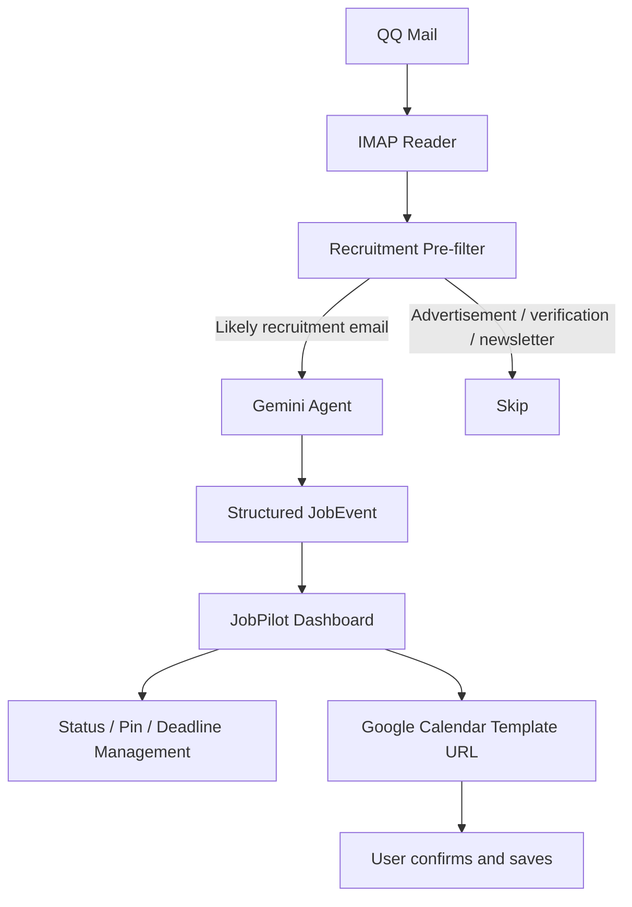

# JobPilot AI

**AI-powered Job Hunting Assistant**  
**AI 秋招求职管理 Agent**

JobPilot AI turns recruitment emails into structured job events, helping candidates keep track of interviews, assessments, deadlines, and application progress in one place.

## Overview

During autumn recruiting, interview invitations, online assessments, written tests, and offers are often scattered across a large inbox. Manually finding each email, recording its deadline, and maintaining application progress is easy to get wrong.

JobPilot AI uses a server-side email and AI pipeline to convert unstructured recruitment messages into actionable `JobEvent` records and presents them in a focused job-hunting dashboard.

```text
QQ Mail
  → IMAP Email Reader
  → Recruitment Pre-filter
  → Gemini AI
  → Structured JobEvent
  → JobPilot Dashboard
  → Deadline / Status Management
  → Google Calendar
```

## Why I Built This

This project explores a practical AI product problem rather than a generic chatbot experience:

- Important recruiting information is buried in long email threads.
- Different recruiting events require different follow-up actions.
- Deadlines and interview times are easy to overlook.
- A useful assistant should turn unstructured input into a reliable workflow, not just return text.

The current version focuses on a complete, demonstrable path from a real QQ Mail inbox to a task-oriented dashboard.

## How It Works



The IMAP service reads the latest 20 messages from the inbox without modifying or deleting them. A local keyword filter first evaluates the subject, sender, and plain-text body. Only likely recruiting emails are sent to Gemini, with a concurrency limit of three analyses. Successful recruitment results are then rendered as dashboard events.

## Features

### Automatic QQ Mail reading

- Reads real QQ Mail messages through IMAP.
- Uses `imap.qq.com` by default with secure port 993.
- Retrieves the latest 20 inbox messages.
- Parses message ID, subject, sender, date, and plain-text content.
- Uses `BODY.PEEK`-style fetching behavior so synchronization does not intentionally mark messages as read.

### Recruitment email pre-filtering

- Performs a broad local check using subject, sender, and body keywords.
- Supports common Chinese and English recruiting terms such as interview, assessment, candidate, campus, hiring, and offer.
- Filters obvious verification emails, newsletters, promotional messages, and similar noise when they have no recruiting signal.
- Reduces unnecessary Gemini calls while favoring recall over aggressive deletion.

### AI information extraction

Gemini classifies candidate emails and extracts a structured `JobEvent`, including:

- Company
- Position
- Event type
- Interview round
- Event date and time
- Deadline
- Meeting type
- Meeting link
- Location
- Status
- AI summary
- Whether human confirmation is needed

The parser supports Chinese and English emails and includes handling for forwarded messages. Missing information is represented as `null` instead of being invented.

### Job-hunting dashboard

The dashboard presents:

- Interviews scheduled this week
- Pending assessments
- Active application processes
- Upcoming events
- A complete recruitment schedule

### Task management

- Manually change an event status.
- Pin important events to the top.
- Persist status and pin overrides in `localStorage`.
- Show deadline and interview countdowns.
- Derive overdue status from the current time.
- Classify urgency as overdue, urgent, soon, or normal.
- Filter the schedule by todo, interview, assessment, completed, overdue, or pinned status.
- Keep completed and cancelled events out of the upcoming list.

### Google Calendar handoff

For events with sufficiently clear timing, JobPilot generates a Google Calendar event template URL:

- Interviews become 60-minute calendar events.
- Assessment, written-test, offer, and material-submission deadlines become 30-minute events ending at the deadline.
- Meeting links and AI summaries are included in the description.
- Events requiring confirmation or missing a key time show `时间待确认` and cannot generate a URL.

This is a user-confirmed handoff. The current version does **not** use Google OAuth, the Google Calendar API, or background calendar synchronization.

## AI Agent Workflow

JobPilot AI is designed as a workflow agent, not only a conversational interface:

```text
Input
  → Classification
  → Information Extraction
  → Validation
  → Structured Event
  → Tool / UI Action
```

The low-cost filtering strategy is intentional:

```text
Ordinary email
  → Local Filter
  → Skip Gemini

Recruitment candidate
  → Gemini
  → JobEvent
```

Local filtering handles high-volume obvious noise. Gemini is reserved for messages that may contain recruiting intent, where semantic interpretation and field extraction are valuable. Each email analysis is isolated, so one failed analysis does not discard successfully parsed events from the same synchronization.

## JobEvent Schema

The application uses a TypeScript `JobEvent` model. A simplified example is:

```json
{
  "company": "Example Company",
  "position": "AI Product Manager",
  "eventType": "面试",
  "eventDate": "2026-10-05",
  "eventTime": "14:00",
  "status": "待参加"
}
```

The full model also includes source email identity, deadline, interview round, meeting details, location, summary, confirmation state, pin state, and an optional timezone. Derived values such as countdown, urgency, and overdue state are calculated at display time rather than stored in the AI response.

## Tech Stack

| Area | Technology |
| --- | --- |
| Web framework | Next.js 16.3.8 |
| UI | React 19, TypeScript |
| Styling | Tailwind CSS 4 |
| AI | Google Gemini via `@google/genai` |
| Email access | IMAP via `imapflow` |
| Email parsing | `mailparser` |
| Calendar handoff | Google Calendar Template URL |
| Application architecture | Next.js App Router, server API routes, client dashboard components |

## Project Structure

```text
app/
  api/
    analyze-email/route.ts  # Manual email analysis endpoint
    emails/route.ts         # Inbox sync and AI analysis endpoint
  page.tsx                  # Application entry point
components/
  Dashboard.tsx             # Client-side dashboard orchestration
  UpcomingEvents.tsx        # Upcoming event cards
  ApplicationsTable.tsx     # Schedule table and filters
  CalendarButton.tsx        # Calendar template handoff
lib/
  email.ts                  # QQ IMAP service
  email-sync.ts             # Pre-filter and concurrent Gemini orchestration
  ai.ts                     # Gemini integration and JobEvent parsing
  calendar.ts               # Google Calendar URL builder
  event-utils.ts            # Countdown, urgency, overdue, sorting, overrides
types/
  job-event.ts              # JobEvent and event-related types
```

## Screenshots

Screenshots can be added here when available:

```text
docs/dashboard.png
docs/email-sync.png
```

The repository currently does not include these image files.

## Getting Started

### Prerequisites

- Node.js compatible with the installed Next.js 16 toolchain
- A QQ Mail account with an IMAP authorization code
- A Gemini API key

### Install and run

```bash
npm install
npm run dev
```

Open [http://localhost:3000](http://localhost:3000).

For a production validation:

```bash
npm run lint
npm run build
npm start
```

### Environment variables

Copy `.env.example` to `.env.local` and fill in the values locally:

```bash
cp .env.example .env.local
```

Required variables:

```dotenv
GEMINI_API_KEY=
EMAIL_USER=
EMAIL_AUTH_CODE=
EMAIL_IMAP_HOST=imap.qq.com
EMAIL_IMAP_PORT=993
```

`EMAIL_AUTH_CODE` is the QQ Mail authorization code, not the QQ login password. Never commit `.env.local` or paste real credentials into source code.

## Privacy & Security

- QQ Mail credentials and the Gemini API key are read only from server-side environment variables.
- Credentials are used by server API routes and are not sent to browser components.
- Email synchronization returns parsed email fields and structured events, not mailbox credentials.
- The IMAP reader does not send, modify, delete, or intentionally mark messages as read.
- `.env`, `.env.local`, and `.env*.local` are ignored by Git.
- The repository includes only a placeholder `.env.example` with empty values.

## Product Decisions

### 1. Local filtering before Gemini

The inbox can contain many irrelevant messages. A local keyword pass is inexpensive, deterministic, and reduces unnecessary LLM calls while keeping the candidate filter broad.

### 2. Never invent missing recruiting details

A wrong interview time is more harmful than an incomplete event. The parser returns `null` and sets a confirmation flag when a field cannot be reliably identified.

### 3. Overdue is derived, not destructive

An overdue event should not silently become completed. The UI derives overdue state from the current time while preserving the user's manual status.

### 4. User-confirmed calendar handoff

The first calendar version opens a pre-filled Google Calendar page instead of requesting OAuth access or modifying a user's calendar in the background. This keeps consent explicit and makes the integration easy to understand and test.

## Future Improvements

The following are future work and are not part of the current implementation:

- Event-driven email sync
- Automatic Google Calendar API integration
- Resume × JD matching
- Interview preparation agent

## Author

**Jiayuan Zhu**

- Portfolio: [jiayuan-portfolio.vercel.app](https://jiayuan-portfolio.vercel.app/)
- GitHub: [Stellalouuu](https://github.com/Stellalouuu)
